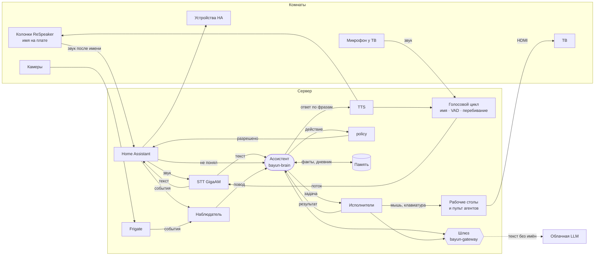
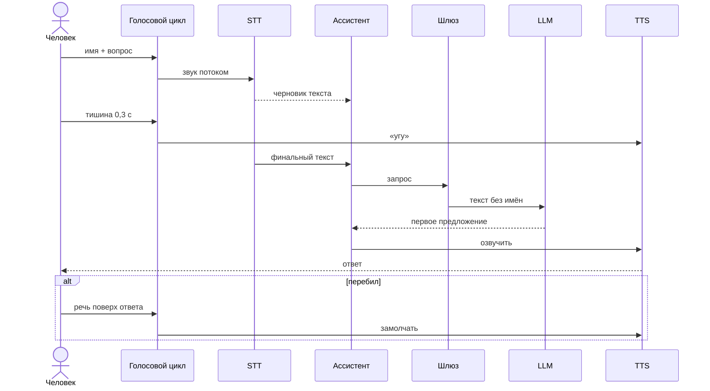
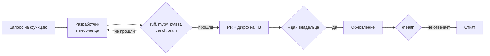

# Агенты, голос и приватность на домашнем сервере

Как внутри одного ноутбука живут агенты ассистента, как идёт голос от имени до ответа и что из дома может уйти в облако. Дополняет [architecture.md](architecture.md) (голосовой тракт, комнаты) и [hardware.md](hardware.md) (железо).

«Баюн» — имя проекта. Как ассистента зовут дома, задаётся в конфиге (`assistant.name`), ниже он называется просто ассистентом.

## Цели

1. Сырой голос, видео, голосовые профили, лица и память о людях не покидают дом.
2. Сложные задачи (исследование, планы, код, работа в браузере) делает сильная облачная модель.
3. Ассистент показывает результат на ТВ и сам управляет мышью и клавиатурой на своём рабочем столе.
4. Реагирует на имя и отвечает почти как живой собеседник: первая фраза ≤ 2 с, можно перебить.
5. Расширяется на все комнаты, камеры, голоса семьи и проактивность.

## Сервер: хост с рабочим столом вместо Proxmox

Ассистенту нужен экран (ТВ по HDMI), а встроенной видеокарте сразу три работы: вывод картинки, OpenVINO для STT и детектор Frigate. На Tiger Lake iGPU не делится между ВМ (GVT-g не поддерживается, SR-IOV экспериментальный), поэтому она остаётся хосту.

```
Debian на железе (хост)
├── libvirt/KVM: ВМ haos — Home Assistant OS (снапшоты перед экспериментами)
├── Docker: bayun-stt, bayun-brain, bayun-gateway, bayun-worker, Piper, Frigate
├── рабочий стол агентов на HDMI → ТВ (отдельный пользователь Linux)
└── iGPU: картинка на ТВ + OpenVINO (STT, Frigate)
```

Минус: хост перестаёт быть «пустым гипервизором». Живой дом защищён тем, что HA в своей ВМ, а сервисы — в контейнерах.

## Компоненты



## Одна личность и слои вокруг неё

Пользователь всегда говорит с одной личностью на сильной модели. Скорость дают локальные слои вокруг неё, а не «лёгкая модель-посредник».

| Слой | Что делает | Чем | Время |
|---|---|---|---|
| Рефлексы (локально) | имя, «угу», конец фразы, перебивание, простые команды | wake word, VAD, интенты HA | ≤ 1 с |
| Ассистент (`bayun-brain`) | разговор, советы, своё мнение, действия в доме через `policy` | облачная модель, ответ потоком по предложениям | первая фраза ~1,6–2,2 с |
| Исполнители (`bayun-worker`) | долгие задачи в фоне: найти и сравнить, план, браузер и рабочий стол на ТВ | Claude Agent SDK | минуты |
| Наблюдатель (`proactive`) | события HA и камер, погода, календарь; будит ассистента поводом, сам не говорит | правила | — |
| Локальный резерв | без интернета: свет, музыка, таймеры | интенты HA, по желанию маленькая локальная модель | — |

Примеры:
- «Выключи свет» — рефлексы, без LLM.
- «Как думаешь, стоит менять резину?» — ассистент, с учётом погоды и памяти.
- «Найди три варианта отпуска и покажи на ТВ» — ассистент сразу отвечает «займусь», ставит задачу исполнителю, тот показывает ход работы на ТВ, ассистент сообщает «готово». Пока задача идёт, можно спросить «как там?» или «отмени».
- Проактивность: Наблюдатель замечает повод («утюг включён час, никого нет»), ассистент решает, стоит ли говорить и где. Лимит частоты и тихие часы обязательны.

Характер задаётся в неизменной части системного промпта и не влияет на задержку и цену (кэш).

## Память: почему контекст не переполняется

Вечного диалога нет. Каждый ответ собирается заново, ~10–20 тыс. токенов:

1. **Рабочая память** — разговор за последние минуты.
2. **Дневник** — каждую ночь ассистент сжимает день в короткое резюме, недели и месяцы сжимаются дальше.
3. **Факты** — люди, предпочтения, договорённости. Хранятся всегда, правятся голосом («что ты про меня знаешь?», «забудь это») и руками.
4. **Дом сейчас** — состояние устройств и присутствие из HA.

Всё хранится локально в SQLite (`schema.sql`). В облако уходит только выбранное для конкретного ответа и только через шлюз.

## Приватность: всё облачное — через шлюз

Ни один агент не ходит в облако напрямую. Между ними и интернетом стоит `bayun-gateway` (на базе LiteLLM proxy).

| Уровень | Что | Наружу |
|---|---|---|
| L0 | сырой звук, видео, голосовые профили, лица, точный адрес, документы | никогда |
| L1 | текст запроса, факты, состояния устройств | только обезличенно: имена → `Человек_1`, адрес → «дом» |
| L2 | снапшот камеры, файл | только по явной просьбе в моменте, лица размыты |

- Обезличивание: словарь имён и мест из памяти + NER (natasha), замены туда и обратно.
- Журнал всего, что ушло наружу: «что ассистент отправил в облако сегодня».
- Выключатель «офлайн»: облако отключено, работает локальный резерв.
- Ключи провайдеров только на шлюзе, у агентов их нет. Дневной лимит трат, общий и по агенту.
- Если провайдер недоступен напрямую, шлюз ходит наружу через свой VPN-сервер (WireGuard): сервер видит только TLS-трафик. Модель меняется одной строкой конфига.
- Условия провайдера (обучение на данных, срок хранения запросов) проверить до запуска.

Текст с камер, веба и писем — недоверенный источник: он не может сам инициировать действия (`untrusted_sources` в `policy.yaml`).

## Голос

### Слушает только после имени

- Постоянно работает только детектор имени: на колонках microWakeWord на ESP32, у сервера openWakeWord. Он держит в ОЗУ кольцевой буфер на 1–2 с и всё время его перезаписывает. Ничего не пишется на диск, не распознаётся и не уходит в сеть.
- После имени берётся ~0,5 с из буфера, чтобы не обрезать начало, поток идёт в STT и закрывается по тишине.
- Пока поток открыт, горит кольцо. На каждом устройстве аппаратная кнопка «микрофон выключен».
- Имя в конце фразы («включи свет, <имя>») не поддерживаем: для этого пришлось бы распознавать всё подряд.
- Требования к имени: редкое в речи и по ТВ, заметные согласные, лучше 3 слога. Кандидатов проверяем на ложные срабатывания на записи дня с включённым ТВ.

### «Почти дуплекс»

Голос-в-голос модели (OpenAI Realtime, Gemini Live) отправляют наружу сырой голос, это нарушает L0. Поэтому дуплекс собираем из шести локальных приёмов:

| Приём | Выигрыш |
|---|---|
| распознавание по ходу фразы | −0,3…0,4 с |
| быстрый конец фразы: пауза 0,3 с + проверка законченности | −0,3…0,5 с |
| запрос в модель по черновику текста | −0,2…0,4 с |
| мгновенное «угу» и смена цвета кольца | пауза не ощущается |
| ответ по предложениям | −2…4 с |
| перебивание: эхоподавление вычитает свой голос, VAD останавливает ответ; после ответа 5–8 с слушает без имени | можно перебить |



Оценка от конца фразы до первого слова: простая команда ~0,6 с; разговор с облачной моделью ~1,6–2,2 с («угу» через 0,4 с); без этих приёмов было бы 5–7 с. Главная неизвестная — первая фраза модели через VPN, замерить первой.

**Решено:** штатный Assist pipeline HA, вероятно, не даёт распознавания по ходу фразы, раннего запроса и перебивания. Поэтому для комнаты с сервером пишем свой голосовой цикл `bayun-voice` на хосте, а колонки в остальных комнатах пока остаются на пайплайне HA и переводятся на свой цикл по мере готовности. Это снимает для этой комнаты пункт «свой аудиосервер в обход HA» из [architecture.md](architecture.md#что-сознательно-не-делаем).

### Голоса

Каталог `voices.yaml`: у каждого голоса движок, диктор и стиль. Ассистент меняет голос сам (инструмент `voice.set`) под настроение, по просьбе или для одной реплики.

| Класс | Движки | Что умеет | Задержка на ноутбуке |
|---|---|---|---|
| Быстрые, по умолчанию | Piper, Silero (CC BY-NC, только некоммерческое использование) | чистая русская речь, несколько дикторов | 0,2–0,3 с |
| Выразительные | XTTS и аналоги с клонированием по образцу | акценты (проверить на слух), эмоции | секунды на фразу: для шуток и сказок |
| Облачные, по выбору | например ElevenLabs | лучшие акценты и эмоции | ~0,3–0,5 с, наружу уходит текст ответа (L1) |

## Экран, мышь и пульт агентов

- Отдельный пользователь Linux, его сессия выводится по HDMI на ТВ. Исполнитель управляет ей через computer use (скриншот → клик или ввод), человек видит это в реальном времени.
- HA переключает вход ТВ на сервер (интеграция Android TV) и возвращает обратно.
- Доступ к почте, календарю и аккаунтам владельца — в отдельном профиле браузера. Отправка, оплата, вход в новые сервисы и удаление — только с подтверждением голосом.
- **Пульт агентов** — страница на этом же столе или панель HA: карточка на каждую задачу (что делает, превью экрана, «одобрить», «ответить», «стоп»). Управление пультом ТВ, голосом или с телефона.
- Агенты думают в облаке, сервер только раздаёт задачи: десяток текстовых агентов он тянет. Агенту с экраном нужен свой виртуальный дисплей (~1 ГБ ОЗУ): на 16 ГБ одновременно 2–3, на 32 ГБ около 8, остальные ждут в очереди.

## Самодоработка



- Агент-разработчик (Claude Code в песочнице) работает в своей копии репозитория и открывает PR. Ставится изменение только после подтверждения голосом или с пульта.
- Без отдельного подтверждения с показом диффа не меняются `policy.yaml`, шлюз, права агентов и сам механизм обновления.
- Автоматизации HA, навыки, промпт и каталог голосов проходят тот же путь с упрощённым подтверждением.

## Камеры

- **Где:** вход, кухня, балкон или окно; в гостиной — только если не смотрит на диван. В спальнях и ванной камер нет: там присутствие ловят mmWave-датчики, которые не дают картинки.
- **Какие:** IP-камеры с RTSP и двумя потоками (основной на запись, второй на детекцию), лучше PoE. Доступ в интернет закрыт на роутере.
- **Обработка дома:** Frigate с детектором OpenVINO на Iris Xe — люди, животные, предметы; распознавание лиц и семантический поиск в свежих версиях Frigate (проверить). Ориентир — 4–6 камер на ноутбуке. Запись только событий, ~2 недели на 1 ТБ.
- **Что это даёт:** присутствие по комнатам (ответ и музыка идут туда, где человек); «кто приходил днём?» лентой на ТВ; «где мои ключи?» локальным поиском; картинка с двери поверх фильма при звонке; пылесос в точку, где камера увидела беспорядок (один раз сопоставить карту пылесоса с кадром).
- **Облако:** кадр уходит только по запросу и с размытыми лицами (L2). Описания с камер — недоверенный источник.

### Режим приватности

1. **Физически.** Камеры в жилых комнатах питаются через умную розетку или реле, в приватном режиме питание отключается; либо камеры со шторкой или поворотом объектива. Это проверяется глазами. Микрофоны — аппаратной кнопкой.
2. **Программно.** Frigate не пишет и не анализирует, буфер последних минут стирается, в память ничего не записывается.
3. **Права.** Выйти из режима может только владелец, кнопкой или голосом из своего профиля. Агенты, Наблюдатель и разработчик не могут ни включить камеры, ни изменить правило: оно в списке запретов `policy.yaml`.

Включается фразой, кнопкой или автоматически (закрытая дверь спальни, расписание). Кольцо показывает, что камеры выключены.

## Устройства

Всё, что подключено к HA, ассистент видит как инструменты через MCP HA: свет, розетки, чайник, пылесос (уборка конкретной комнаты — сегментная уборка в интеграции пылесоса), датчики. Новое устройство подключается к HA, коду ассистента ничего дописывать не нужно.

## Ресурсы на 16 ГБ

| Что | ОЗУ |
|---|---|
| ВМ haos | 3–4 ГБ |
| STT + TTS + wake word | 1,5–2 ГБ |
| brain, gateway, worker | 1–1,5 ГБ |
| Рабочий стол + браузер (+ ~1 ГБ на агента с экраном) | 2–3 ГБ |
| Frigate | 1–2 ГБ |
| Хост | 1–1,5 ГБ |
| **Итого** | **10–14 ГБ** |

Влезает, но без локальной LLM. Если есть свободный слот, 32 ГБ стоит поставить сразу.

## Деньги

Подписка Claude Pro — личный доступ к claude.ai и Claude Code с лимитами по 5-часовым окнам, для сервиса 24/7 она не подходит. Её можно использовать для агента-разработчика, которому задачи ставят вручную. Ассистенту нужен API-ключ с оплатой за токены.

Оценка на 50 разговоров в день, ~15 тыс. токенов контекста на ответ (большая часть из кэша), цены октября 2026:

| Модель ассистента | Один ответ | В месяц |
|---|---|---|
| Sonnet 5.5 | 2–4 цента | ~$30–60 |
| Opus 5.5 | 4–8 центов | ~$70–120 |
| Haiku 5.5 | ~0,2 цента | ~$2–5 |
| Смесь: простое на Haiku, разговоры на Sonnet | — | ~$15–30 |

Наблюдатель почти бесплатен (правила локальные), ночной дневник ~$3–5 в месяц. Старт: смесь моделей и лимит $1 в день на шлюзе, через неделю сверить с журналом.

## Открытые вопросы

- [ ] Как `bayun-voice` отдаёт простые команды в интенты HA (conversation API) и как переводить на него колонки ESPHome.
- [ ] Что HA уже умеет: потоковый ответ в TTS, перебивание, продолжение разговора без имени.
- [ ] Задержка первой фразы облачной модели через VPN-сервер.
- [ ] Распознавание лиц и семантический поиск во Frigate: версия, качество, нагрузка на Iris Xe.
- [ ] Акценты в выразительных TTS: проверить на слух и замерить скорость на CPU.
- [ ] Интеграция пылесоса и уборка по комнатам.
- [ ] Условия облачного провайдера по хранению данных.
